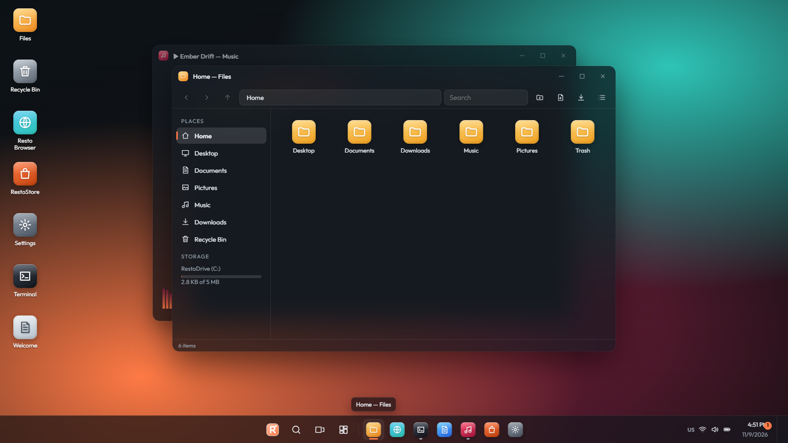
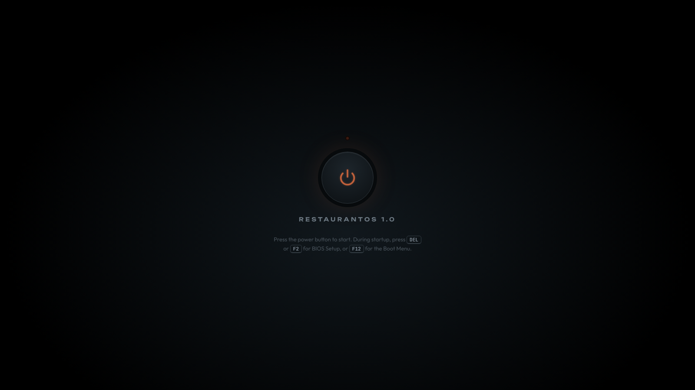
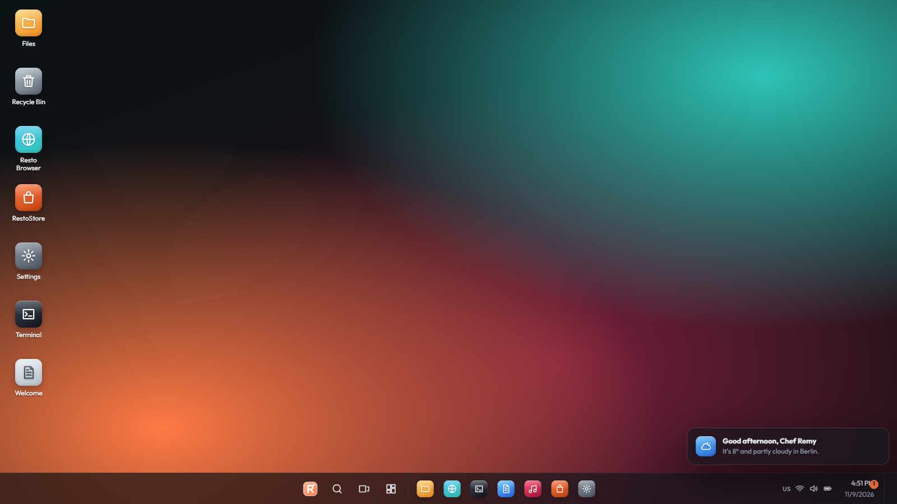

<div align="center">

# 🍽️ RestaurantOS 1.0

**A complete desktop operating system that runs in your browser.**
It has a power button, a BIOS, a boot screen, a setup wizard, a lock screen and a full desktop with more than 30 apps and games, all in **one HTML file**.


[](https://sigeonrestaurantstudios.github.io/RestaurantOS/)




</div>

---

## 🚀 Try it

### ▶️ **[Play RestaurantOS live in your browser](https://sigeonrestaurantstudios.github.io/RestaurantOS/)**

Or run it offline:

1. Download **[`RestaurantOS.html`](RestaurantOS.html)**.
2. Open it in any modern browser.
3. Press the power button. 🔌

You don't need a server, an account or an install. Everything you do is saved in your browser.

## ✨ Features

### 🖥️ A real boot experience
- A power button, a **BIOS setup** (`DEL` / `F2`), a **boot menu** (`F12`) and recovery options
- A boot splash screen and a first-run **setup wizard** for language, region, network, account, privacy and personalization
- A **lock screen**, with an optional password and password hint

### 🪟 The desktop
- Windows you can drag, resize and **snap**, plus a taskbar and a Start menu
- **Virtual desktops**, **widgets**, notifications and a clipboard history
- Live wallpapers (Aurora, Nebula, Waves), themes and accent colors, plus night light and a screensaver
- System updates, with a "What's new" screen

### 📦 Apps
| | |
|---|---|
| 📁 **Files** | A file manager with a virtual drive and a Recycle Bin |
| 🌐 **Resto Browser** | A browser with tabs |
| 🛍️ **RestoStore** | An app store that installs apps and games |
| 💻 **Terminal** and **Code Studio** | A command line and a code editor |
| 📝 **Notepad**, **Sheets**, **Sticky Notes** and **To Do** | Tools for notes and work |
| 🎵 **Music**, **Photos**, **Paint** and **Piano** | Creative apps |
| 📅 **Calendar**, **Clock**, **Weather** and **Calculator** | Everyday utilities |
| 🍳 **Recipe Book** and **Unit Converter** | Kitchen tools that fit the restaurant theme |
| 💬 **Nova** | A chat assistant |
| 📊 **Task Manager** and **Settings** | Control over the whole system |

### 🎮 Games
Snake · Minesweeper · 2048 · Breakout · Blocks · Memory Match · Tic-Tac-Toe · **Order Up!** · **RestoDefender**

## 📸 Screenshots

| Power on | Desktop |
|---|---|
|  |  |

## 🛠️ Building from source

The source is split into modules in `src/`. `build.sh` bundles them into the single `RestaurantOS.html`:

```bash
sh build.sh
```

```
RestaurantOS/
├── RestaurantOS.html   # Built, self-contained OS (open this)
├── build.sh            # Bundles src/ into RestaurantOS.html
└── src/
    ├── head.html, body.html   # Page shell and stages (power, BIOS, boot, setup, lock, desktop)
    ├── style.css, v2.css      # Styles
    ├── core1.js, core2.js     # Kernel: storage, firmware, boot, setup, windows, taskbar
    ├── apps1-3.js             # Built-in apps
    ├── games.js               # Games
    └── v2.js                  # 1.0 features and updates
```

## 📄 License

RestaurantOS is licensed under the **[GNU Affero General Public License v3.0](LICENSE)**.

You may use, modify and share it, as long as:
- you **credit the original author** (Sigeon Restaurant Studios) and keep the copyright and license notices
- any modified version you distribute is **also open source** under AGPL-3.0, and that includes versions you run as a website or online service

Copyright © 2026 Sigeon Restaurant Studios

## 🤝 Contributing

Issues and pull requests are welcome. If you find a bug or have an idea for an app, open an issue.

---

<div align="center">
Made by <a href="https://github.com/sigeonrestaurantstudios">Sigeon Restaurant Studios</a> 🐦
</div>
